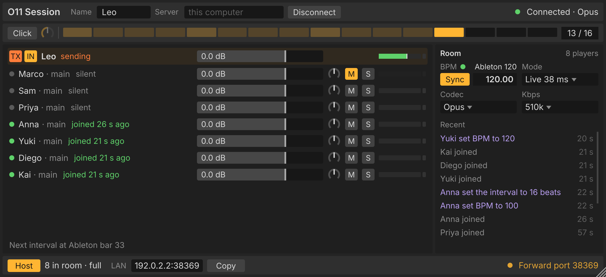

<div align="center">

# O11 Session

### Play with your band over the internet, inside your DAW.


[**Download**](#download) · [Live mode](#live-mode) · [Intervals mode](#intervals-mode) · [Ableton Link](#sync-with-ableton-link) · [Per-player outputs](#per-player-outputs) · [Timing](#timing) · [FAQ](#faq)

</div>

<p align="center"></p>

O11 Session is a VST3 plug-in for playing with your band over the internet,
each of you in your own DAW. One player hosts the room inside the plug-in; the
others join with its address.

- **Two modes.** Live sends audio straight to every player as you play.
  Intervals plays everyone one interval late, on the beat, at any distance.
- **Sync.** Your DAW follows the room's tempo and bars through Ableton Link.
- **Per-player outputs.** Each player can go to their own track in your DAW.
- **No server to run.** The host's plug-in is the server.

## Download

| Platform | Download |
|---|---|
| **macOS, Apple silicon** (M1 and later, macOS 12+) | [O11Session-macos-arm64.dmg](https://github.com/LeonidStern/session/releases/download/o11session-latest/O11Session-macos-arm64.dmg) |
| **macOS, Intel** (macOS 12+) | [O11Session-macos-x86_64.dmg](https://github.com/LeonidStern/session/releases/download/o11session-latest/O11Session-macos-x86_64.dmg) |
| **Windows** (64-bit) | [O11Session-windows-x64.zip](https://github.com/LeonidStern/session/releases/download/o11session-latest/O11Session-windows-x64.zip) |
| **Linux** (x86_64) | [O11Session-linux-x86_64.zip](https://github.com/LeonidStern/session/releases/download/o11session-latest/O11Session-linux-x86_64.zip) |

These links always point to the newest build. It runs in any VST3 host.

**Install or update from the terminal** (macOS and Linux). This puts the newest
build in `~/Library/Audio/Plug-Ins/VST3` on macOS (after checking its signature)
or in `~/.vst3` on Linux, replacing the copy that is there:

```sh
curl -fsSL https://raw.githubusercontent.com/LeonidStern/session/main/install.sh | sh
```

Add `-s rc0.2` after `sh` for a release candidate instead of the newest build.

## Quick start

1. **Install.** On macOS, open the disk image, open `/Library/Audio/Plug-Ins/VST3`
   (in Finder: Go, Go to Folder), and drag O11 Session into that folder's window (it is signed and notarized by Apple). On Windows, copy
   `O11Session.vst3` into `C:\Program Files\Common Files\VST3`. On Linux, copy
   it into `~/.vst3`. On macOS and Linux, the
   [one-line terminal install](#download) does this for you and also updates later.
   Then rescan plug-ins in your DAW.
2. **Start a room.** Put O11 Session on a track and press Host. It opens the
   room on your computer, asks your router to let people in, and shows the
   address to share.
3. **Invite your band.** They paste the address into their own copy and join.
4. **Play.** Each player arrives on their own output in your DAW
   ([outputs](#per-player-outputs)).

## Live mode

Live sends your audio directly to every other player, with no server in
between: 10 ms Opus frames at 128 kbps, and a buffer that starts at 10 ms and
moves to 20 ms on a connection that can't hold 10 ms. It stays in time only
while everyone hears everyone within about 50 ms. When someone is farther
away, drops out or can't reach the others directly, the room says who and
suggests Intervals; one click switches the whole room.

<p align="center"></p>

## Intervals mode

Everyone hears everyone else one interval late, so it lines up on the beat at
any distance. Intervals are 2, 4, 8, 12 or 16 beats (4 by default). Audio is
Opus up to 510 kbps, or lossless FLAC, relayed through the host. A switch
between Live and Intervals fades over 20 ms, and the room keeps its tempo and
settings.

## Sync with Ableton Link

With Sync on, the plug-in leads your DAW's tempo through Ableton Link and lines
your bars up with the room's intervals. Changing the tempo in your DAW votes
for it in the room. In DAWs without Link the room follows your DAW's tempo.

## Timing

Each player's audio is played slightly faster or slower to keep its buffer
steady, so the delay doesn't drift. When a player's computer stalls, listeners
absorb the gap instead of staying behind. Lost packets are asked for again;
what still doesn't arrive is concealed and faded out.

## Per-player outputs

Besides the main mix, the plug-in has eight stereo outputs, "Player 1" to
"Player 8"; each player's row shows theirs (P1 to P8). In Ableton, create an
audio track, set its Audio From to the O11 Session track and pick the player's
output.

## FAQ

**Do I need a server?** No. One player presses Host and the room runs in
their plug-in.

**Live or Intervals?** Live only works when everyone is close (within about
50 ms). Otherwise use Intervals.

**Does it work with my DAW?** Any VST3 host on macOS, Windows or Linux.

## Licence

Free to download and use, not open source: see [LICENSE](LICENSE) and
[THIRD_PARTY_NOTICES.txt](THIRD_PARTY_NOTICES.txt).
